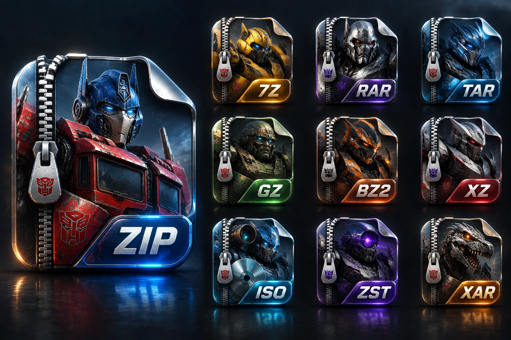

# 第三方图标合集（用户自定义）

本页保存用户提供的第三方图标合集，仅供个人参考和手动替换使用，**不随 New7z 安装包分发**，也不属于 New7z 的内置图标主题。

## 变形金刚主题

### 版权声明

Transformers（变形金刚）及相关角色、名称、标志的版权与商标归 **Hasbro, Inc. / Takara Tomy Co., Ltd.** 等原权利人所有。该合集不是 New7z 作者创作或授权的内容，版权不属于 New7z 作者，也不属于提供图片的用户；本仓库不应被理解为获得了原权利人的授权、许可或背书。

本仓库仅应要求保存用户提供的图片，供说明自定义图标功能。**请勿将本图或其裁切结果用于商业用途或再次分发**；是否使用、复制、修改或在本地应用该图片，由你自行判断并承担相应责任。New7z 的 MIT 许可不适用于本页图片。

### 使用方法

New7z 不提供一键导入这张合集的功能，需要自己裁切后逐个替换：

1. 用图片编辑工具按下图布局裁出单个图标：左侧大图为 ZIP，右侧 3×3 网格依次为 7Z、RAR、TAR / GZ、BZ2、XZ / ISO、ZST、XAR。
2. 将单个图标保存为 PNG（建议至少 128 × 128，保留透明背景）。
3. 打开 New7z → 设置 → 外观与图标 → 压缩文件图标，对目标格式点击「替换」，选择裁好的 PNG。
4. 想恢复时点击该格式的「恢复默认」，会回到当前图标主题的图标。

当前设置页只提供 7z、ZIP、RAR、TAR、GZ、BZ2、XZ、ISO 八个格式的替换入口；ZST、XAR 图标可以在其他场景自行使用，但 New7z 目前不为它们显示格式图标或注册文件关联。

单个格式的「替换」只影响 New7z 应用内显示。内置的「图标主题」会同步到 New7z 的文件关联图标；如果希望资源管理器也显示，需要切换主题并把对应格式的默认程序设为 New7z（Windows 设置 → 默认应用，或在 New7z 设置 → 文件关联中选择）。

## 其他合集

其他用户提供的图标合集可以按同样方式放入本目录并在本页登记，同时注明来源和权利归属。未声明许可的第三方图片不会被加入安装包。
